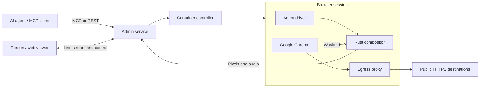

# easi.run · Engineering a browser runtime for AI agents

**Juliano Sig — creator & maintainer**  
Rust · TypeScript · Svelte · MCP · Docker · Linux

[Source](https://github.com/julianosig/easi.run) · [Live demo](https://easi.run/demo/) · [Architecture](https://github.com/julianosig/easi.run/blob/main/docs/architecture.md) · [Agent workflow example](./AGENT-WORKFLOW.md)

## The problem

A browser agent needs more than a way to click. It needs a usable session, durable state, file transfers and a way for a person to step in when the workflow reaches a login or another human decision. The person also needs to see what the agent is doing.

easi.run brings these requirements into a self-hosted product: each agent can work in a real Chrome session, a person can watch and take control, and saved profiles can resume later.

My work spans the Rust runtime, browser/session infrastructure, agent interfaces, viewer and admin UI, deployment and technical documentation. This case describes the public implementation; it makes no claims about customer counts or commercial adoption.

## Architecture at a glance

The controller holds Docker access. Browser, display, proxy and agent are separate components. The viewer receives compositor-produced media; the agent reaches the session through the tools exposed to it.

## Decision 1 · Build the display path around browser interaction

The project uses a Rust Wayland compositor with lossless tiles for ordinary screen changes and AV1 for motion. The TypeScript viewer decodes the stream in the browser. WebSocket carries the connection, with WebTransport used for media when UDP is reachable.

**Why this design:** readable text, low traffic when the page is idle, and a live view that includes browser windows and native interaction. The compositor sees damaged regions directly, making it possible to treat text and motion differently.

**Alternatives documented in the project:** VNC/RDP-based compositors, DevTools screencasting, WebRTC-based stacks and kernel capture. Each brings different constraints around native dialogs, deployment, devices, protocol overhead or operational complexity.

**Tradeoff:** a custom compositor, protocol and encoder pipeline require more implementation and testing. AV1 encoding costs CPU and memory; performance depends on the workload and client. [Design and alternatives](https://github.com/julianosig/easi.run/blob/main/docs/design.md) · [Picture path](https://github.com/julianosig/easi.run/blob/main/docs/architecture.md#the-picture-path)

## Decision 2 · Make human takeover a control boundary

Watching a session and controlling it are separate states. A control lease and advancing epochs determine whose input is accepted. Taking control blocks new agent commands and waits for in-flight work within a bound; the documented fallback can terminate the agent component or stop the session if a safe handoff cannot be established.

**Why this design:** a person and an agent must not type into the same login or confirmation at the same time. Stale input must not become valid after control changes.

**Tradeoff:** takeover is a state transition with failure cases, cancellation and recovery logic. Redaction also has explicit limits: permissions such as page scripts or CDP can grant broader access. [Control design](https://github.com/julianosig/easi.run/blob/main/docs/design.md#36-control-and-the-agent) · [Security boundaries](https://github.com/julianosig/easi.run/blob/main/docs/security.md)

## Decision 3 · Keep session authority explicit

The admin service, controller, browser, agent and proxy have different responsibilities. The controller accepts a closed set of container operations, while the egress proxy restricts reachable destinations. Agent tokens determine which saved profiles can be listed or resumed. Persistent browser state is stored encrypted.

**Why this design:** browser content, an agent API token and Docker access should not imply the same authority. Self-hosting also needs clear operational boundaries that an administrator can inspect.

**Tradeoff:** deployment has multiple services and Linux/Docker requirements. A saved browser login still carries the account's authority; allowing an agent to resume it is an access decision. [Topology](https://github.com/julianosig/easi.run/blob/main/docs/topology.md) · [Security model and mapped tests](https://github.com/julianosig/easi.run/blob/main/docs/security.md)

## Measured results

These are the project's **published laboratory results from 2026-10-21**, not measurements rerun for this profile. The comparison uses the same host and Chrome, a 1280×800 output and the same total CPU budget for the screen path. Results below are headless medians from completed repetitions.

| Metric / fixture | easi.run | KasmVNC |
| :--- | ---: | ---: |
| Smooth scrolling, presented frames/s | 54.9 | 24.4 |
| Text scrolling, bitrate | 1,862 kbit/s | 16,433 kbit/s |
| Text scrolling, SSIM | 0.990 | 0.977 |
| Typing, input-to-draw p50 / p95 | 28 / 37 ms | 69 / 82 ms |
| Full-motion transform, presented frames/s | 37.7 | 24.4 |

For text scrolling, the measured bitrate was about **88.7% lower**, with the SSIM values above. This applies to that fixture and configuration.

The measurements also expose remaining work: the 55 fps full-motion target was missed; video and transform missed capture-to-draw latency targets. KasmVNC used less memory on every measured fixture and less CPU on some fixtures. These costs matter when choosing a runtime for a workload.

[Method, hardware, failed runs and full results](https://github.com/julianosig/easi.run/blob/e823c9388f92f45ce40f0bfad9a0f071c910131f/docs/benchmark.md) · [Raw measurement artifacts](https://github.com/julianosig/easi.run/tree/e823c9388f92f45ce40f0bfad9a0f071c910131f/bench/results/2026-10-21)

## What to inspect as a reviewer

| Engineering area | Evidence |
| :--- | :--- |
| Systems / streaming | [`display/src`](https://github.com/julianosig/easi.run/tree/main/display/src), [`protocol`](https://github.com/julianosig/easi.run/tree/main/protocol) |
| Agent API and orchestration | [`admin/src/mcp.rs`](https://github.com/julianosig/easi.run/blob/main/admin/src/mcp.rs), [`service.rs`](https://github.com/julianosig/easi.run/blob/main/admin/src/service.rs) |
| Isolation and container lifecycle | [`controller`](https://github.com/julianosig/easi.run/tree/main/controller), [`proxy`](https://github.com/julianosig/easi.run/tree/main/proxy) |
| Product interface | [`client/src`](https://github.com/julianosig/easi.run/tree/main/client/src) |
| Testing and reproducibility | [`tests`](https://github.com/julianosig/easi.run/tree/main/tests), [`bench`](https://github.com/julianosig/easi.run/tree/main/bench), [`CONTRIBUTING.md`](https://github.com/julianosig/easi.run/blob/main/CONTRIBUTING.md) |

The project demonstrates the part of AI engineering I focus on: connecting agent tools to usable systems, giving people clear control, and making the implementation and its constraints inspectable.

[Back to profile](./README.md) · [Experience](./EXPERIENCE.md)
