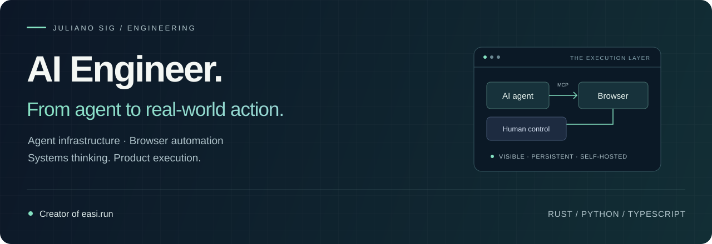

  <a href="https://easi.run"><strong>Try what I build ↗</strong></a> &nbsp; · &nbsp;
  <a href="./EXPERIENCE.md">Experience</a> &nbsp; · &nbsp;
  <a href="./Juliano-Sig-Resume.pdf">Resume PDF</a> &nbsp; · &nbsp;
  <a href="https://x.com/jul1anodev">Talk to me on X</a>

## I build the infrastructure that lets AI agents do useful work.

I'm **Juliano Sig**, an AI Engineer focused on **agent infrastructure, browser automation and full-stack products**. Founder of **Shimpz** and creator of **[easi.run](https://easi.run)**.

My work connects the agent to the real application: browser sessions, APIs, permissions, persistent state, files and the interface a person uses to step in. I work across Rust systems, Python backends and TypeScript interfaces, from the underlying service to the product people use.

### Featured work · easi.run

**Self-hosted Chrome sessions for people and AI agents.** An open-source project that brings browser control, live viewing and human takeover into one workflow.

| Engineering problem | What I built in easi.run |
| :--- | :--- |
| An agent needs to use a real browser | MCP and REST tools, plus optional CDP access for existing automation |
| A login needs a person | Live viewing and control handoff that pauses agent actions |
| Work must survive the next session | Encrypted saved browser profiles and permissions per agent token |
| Browser access needs boundaries | Container separation, restricted network egress and a documented security model |
| People need to see what happened | An action timeline, session recording and replay |
| Remote interaction needs to feel responsive | A Rust compositor and streaming pipeline, with reproducible benchmarks |

**[Source ↗](https://github.com/julianosig/easi.run) · [Live demo ↗](https://easi.run/demo/) · [Architecture ↗](https://github.com/julianosig/easi.run/blob/main/docs/architecture.md) · [Security model ↗](https://github.com/julianosig/easi.run/blob/main/docs/security.md) · [Benchmarks ↗](https://github.com/julianosig/easi.run/blob/main/docs/benchmark.md)**

**Read the engineering:** [Architecture decisions & measured results](./EASI-CASE-STUDY.md) · [Reproducible agent workflow](./AGENT-WORKFLOW.md)

In the published headless benchmark, text scrolling used **1,862 kbit/s versus 16,433 kbit/s** for KasmVNC, with SSIM of 0.990 versus 0.977. Typing input-to-draw p50 was **28 ms versus 69 ms**. These are laboratory measurements from 2026-10-21; the case study includes conditions, missed targets and resource tradeoffs.

### More of my engineering work

| Project | Focus | Stack |
| :--- | :--- | :--- |
| **[pyhouse](https://github.com/julianosig/pyhouse)** | A Python query-building library for ClickHouse, with entities, filters, joins, aggregation and pagination | Python · ClickHouse |
| **[cryptoarbs-front](https://github.com/julianosig/cryptoarbs-front)** | Application frontend with authentication, account settings, exchange credentials and subscription screens | SvelteKit · TypeScript · Tailwind CSS |

These repositories show different stages of my work, including experiments and earlier implementations. **[Read the experience notes →](./EXPERIENCE.md)** for scope and technical context.

### Where I can contribute

**Agent infrastructure** — MCP tools, browser runtimes, persistent sessions, human control and API integrations.

**Backend & data systems** — Python, Django, REST APIs, WebSockets, PostgreSQL, Redis and ClickHouse.

**Product & systems engineering** — Rust, TypeScript, Svelte, Docker, Linux, CI, technical documentation and interfaces that make complex systems usable.

Alongside open source, my private project work includes data collection, backend services, market-data integrations and payment workflows. I describe that experience without publishing private source code or internal project details.

### Let's build something useful.

I'm interested in **AI engineering, agent infrastructure and product engineering opportunities**. If your team needs someone who can connect the systems work to the user experience, **[let's talk](https://x.com/jul1anodev)**.

I share what I'm building on **[X @jul1anodev](https://x.com/jul1anodev)**. Follow along for browser agents, engineering decisions and new releases.
